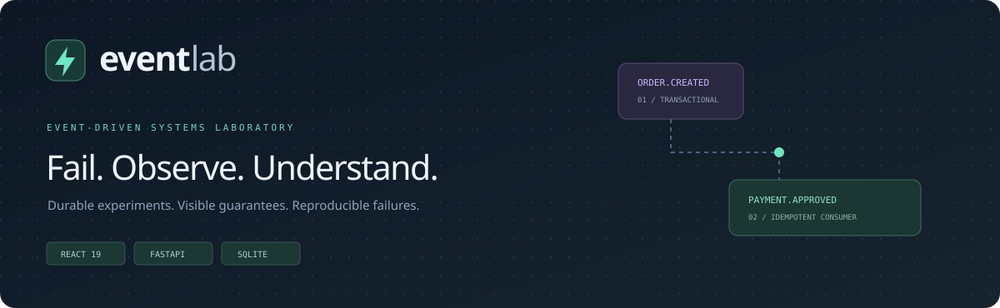
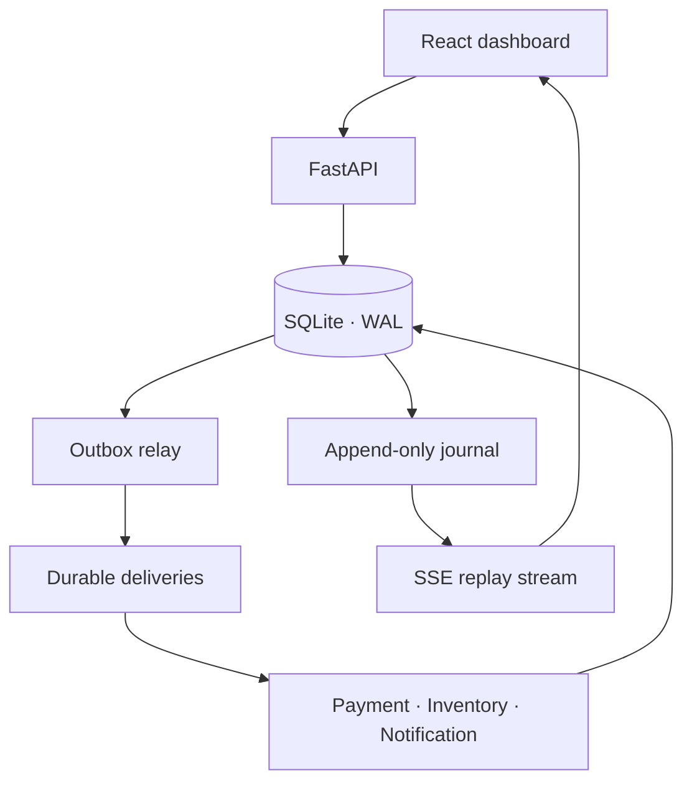

<p align="center"></p>

<p align="center">
  <a href="https://github.com/emerson998/EventLab/actions/workflows/ci.yml"></a>
  
  
  <a href="LICENSE"></a>
</p>

**An interactive laboratory for understanding what happens when event-driven systems fail.** Create an order, pause a consumer, lose an acknowledgement, exhaust retries, and observe how durable publication and idempotent consumers change the outcome.

[Português brasileiro](docs/README.pt-BR.md) · [Architecture](docs/architecture.md) · [Experiments](docs/experiments.md) · [API](docs/api.md) · [Operations](docs/operations.md) · [Contributing](CONTRIBUTING.md)

## Why EventLab?

Architecture diagrams explain the happy path. EventLab makes the failure path observable: the original event, delivery attempts, business effects and causation chain remain inspectable after a restart. It is designed for learning, technical demonstrations and architecture discussions.

**Scope:** EventLab is a persistent, single-process simulator with a local SQLite transport. Payment, inventory and notification are logical consumers, not separately deployed microservices. No real payments, stock changes or emails occur. The publication-gap scenarios model a failure window; they do not terminate the process. Kafka/RabbitMQ adapters and distributed workers are not implemented.

## What you can do

- Create isolated experiments with six failure presets and adjustable retry budgets.
- Follow orders through payment → inventory → notification in a responsive React dashboard.
- Inspect event envelopes, versioned payloads, order correlation and parent-event links.
- Pause the whole experiment or individual consumers without discarding queued messages.
- Inject transient failures, persistent failures, delivery latency and lost acknowledgements.
- Observe exponential retry scheduling, dead-letter messages, replay generations and deduplication.
- Compare durable Transactional Outbox publication against a simulated direct-publish loss window.
- Resume pending publications and retries after an API restart.
- Stream the durable journal over SSE with cursor-based reconnection and heartbeat messages.
- Export a consistent experiment snapshot, including the complete journal, as JSON.
- Use an optional shared bearer token, strict request validation and idempotent order creation.

## Start in one command

Install Docker with Compose v2, clone this repository, and run:

```bash
git clone https://github.com/emerson998/EventLab.git
cd EventLab
docker compose up --build -d
```

| Interface | Address |
| --- | --- |
| Dashboard | http://localhost:8080 |
| Interactive API documentation | http://localhost:8000/docs |
| Readiness | http://localhost:8000/readyz |

Open **Novo experimento**, choose **Fluxo saudável**, then **Criar pedido**. A successful order produces four events and three business effects. The interface and experiment messages are in Brazilian Portuguese.

For the clearest failure demonstration, create **ACK perdido**. The payment effect commits, acknowledgement is lost, and the redelivery is deduplicated. The final order still has exactly three local business effects.

```bash
docker compose logs -f
docker compose down
```

The named volume survives `down`. See [operations](docs/operations.md) for backup, token configuration and explicitly destructive reset instructions.

## Run without Docker

Requirements: Python 3.11+, Node.js 22.12+ and npm. The commands below use a POSIX shell. On Windows, use Docker Desktop/WSL or the PowerShell activation command noted below.

```bash
python -m venv .venv
.venv/bin/python -m pip install -r backend/requirements-dev.lock
cd backend
../.venv/bin/python -m uvicorn eventlab.main:create_app --factory --host 127.0.0.1 --port 8000
```

In a second terminal:

```bash
cd frontend
npm ci
npm run dev
```

Open http://localhost:5173. Vite proxies `/api` to the backend. On Windows PowerShell, activate `.\.venv\Scripts\Activate.ps1` from the root, then use `python` instead of `.venv/bin/python` and `../.venv/bin/python`. No environment file is loaded automatically in native mode; export variables in the shell before starting the API.

## Six experiments

| Preset | Injected condition | Expected observation |
| --- | --- | --- |
| Healthy | None | Four events, three effects, completed order |
| Retry | First two payment attempts fail | Backoff of 1s and 2s by default, then recovery |
| Dead letter | Payment continues failing | DLQ after three attempts; fix and replay |
| Lost ACK | Payment commits but ACK is lost | Redelivery is ignored by the inbox |
| Outbox recovery | Publication delayed for 4s | Intent survives; order eventually completes |
| Direct loss | Same gap without publication intent | Order exists; no payment delivery is created |

Presets configure a **run-level failure budget**, consumed across orders. Retry settings are editable; the recovery preset needs at least three attempts. See [step-by-step experiments](docs/experiments.md).

## Architecture at a glance



The engine uses short transactions instead of sleeping workers. `available_at` persists delivery latency and retry eligibility. A consumer commits its inbox entry, business effect, order transition and next outbox event atomically. Injected ACK loss happens after that logical commit, so a subsequent delivery finds the inbox marker.

The local outbox-to-delivery transfer is also atomic because both tables live in SQLite. This is stronger than the handoff to an external broker. Real broker publication would need publisher confirmation and tolerate duplicate publication; EventLab demonstrates redelivery explicitly rather than claiming an external exactly-once guarantee.

## Quality and verification

```bash
# Backend: domain, API, concurrency, rollback, restart, real HTTP SSE and worker lock
cd backend
../.venv/bin/python -m pytest -q
../.venv/bin/ruff check .
../.venv/bin/ruff format --check .

# Frontend: protocol, auth, error and component tests, type checks, production build
cd ../frontend
npm test
npm run build

# Browser integration tests; starts backend and Vite automatically
npx playwright install --with-deps chromium
npm run test:e2e
```

CI runs the backend on Python 3.11 and 3.12, frontend tests/build, Chromium integration tests, dependency auditing and Docker Compose smoke tests. Local verification status and environment limitations are recorded in [validation](docs/validation.md); a workflow definition alone is not proof of a passing remote run.

## Project map

```text
backend/eventlab/       API, settings, SQLite store and deterministic engine
backend/tests/          Domain, API and live HTTP integration tests
frontend/src/           Typed React UI, API client, SSE protocol and unit tests
frontend/e2e/           Browser tests against the real application
frontend/nginx.conf     Same-origin reverse proxy with unbuffered SSE
scripts/                Repository smoke-check helpers
docs/                   Architecture, API, operations, experiments and PT-BR guide
.github/workflows/      Automated checks
```

## Boundaries

This is a shared local laboratory, not a multi-tenant payment platform. Use **one API worker per database**; a cross-platform file lock rejects a second scheduler. SQLite must use a local filesystem with working file locks. There is no external broker, distributed ordering guarantee, saga compensation, OAuth, per-user authorization, rate limiting, import/restore API or real service side effect. Exports support inspection, not import.

By default, Docker ports bind only to loopback. If you expose the application, configure TLS, a bearer token and infrastructure-level request/connection limits. Do not put real customer data in experiments. More operational detail: [operations](docs/operations.md) and [security](SECURITY.md).

## Contribute

Contributions that make failure guarantees easier to understand are welcome. Start with [CONTRIBUTING.md](CONTRIBUTING.md), the [architecture decisions](docs/architecture.md#decisions) and the [roadmap](docs/roadmap.md).

Created by [Emerson Oliveira](https://github.com/emerson998). Licensed under [MIT](LICENSE).
