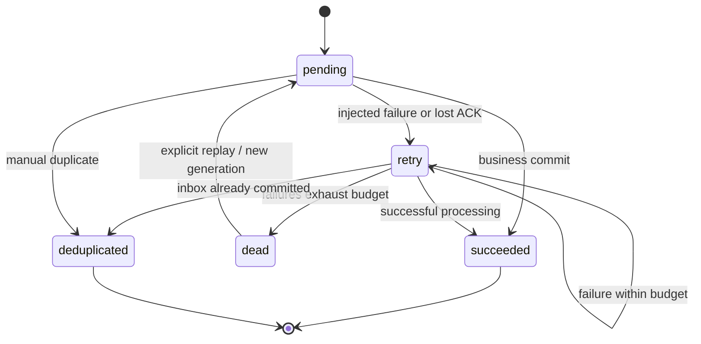

# Architecture and delivery guarantees

## Design goal

Make event-driven failure modes reproducible, durable and inspectable on one developer machine. The simulator implements real database transactions and persistent scheduling while representing consumers and transport in a single process. It deliberately does not model network partitions or broker internals.

## Modules

| Module | Responsibility |
| --- | --- |
| `models.py` | Bounded, whitespace-normalized request contracts; rejects unknown fields |
| `config.py` | Environment configuration with explicit local defaults |
| `store.py` | Schema v1, connections, foreign keys, WAL and transaction boundaries |
| `engine.py` | Orders, logical consumers, faults, relay, retries, replay and read models |
| `main.py` | HTTP contracts, authorization, worker lifecycle, readiness and SSE |
| `frontend/src/api.ts` | Typed requests, session token and resumable SSE parsing |
| `frontend/src/App.tsx` | Experiment workflow, topology, controls, journal and inspectors |

## Event chain

| Source | Event | Subscriber | Order state after consumption |
| --- | --- | --- | --- |
| orders | `order.created` | payment | paid |
| payment | `payment.approved` | inventory | reserved |
| inventory | `inventory.reserved` | notification | completed |
| notification | `notification.sent` | none | terminal observation |

Every event has an immutable UUID, `order_id` as correlation identifier, parent `causation_id`, logical source/target and payload schema version. Amounts are positive integer cents. No floating-point arithmetic is used for persisted amounts.

## Publication transaction

In outbox mode, order creation writes the order, event envelope, journal entries and publication intent inside one `BEGIN IMMEDIATE` transaction. If any write fails, all roll back. A relay tick inserts a durable delivery and marks the intent published in another single transaction.

In direct mode, the simulator normally inserts a delivery immediately. With a publication gap injected, it commits the order and event journal but omits the delivery. This represents the real-world dual-write window between a business commit and publishing to a separate transport. It is an explicit educational fault model, not an actual process crash.

The outbox recovery preset delays relay eligibility by four seconds. An actual application restart during this period is supported: the persisted intent remains eligible afterwards. Tests also reconstruct the engine against the same database to verify recovery.

## Consumer transaction

1. Select due deliveries for unpaused runs and consumers.
2. Increment the attempt counter.
3. Check the inbox key `(run_id, event_id, service)` before applying a fault or effect.
4. A known key finishes as `deduplicated` without another effect or downstream event.
5. An injected failure decrements the remaining fault budget and schedules retry or DLQ.
6. Success inserts the inbox marker and effect, advances the order, and creates the next event and outbox intent.
7. Mark delivery successful, or simulate a lost acknowledgement by scheduling redelivery.
8. Commit the entire tick transaction.

`effects` also has a unique constraint on `(run_id,event_id,service)`. Business and dedupe writes cannot diverge. This is local idempotency; a real external charge would require the payment provider's own idempotency key and reconciliation.

## Delivery state machine

Manual duplication creates a separate delivery with the same immutable event ID. It never copies an event or changes the business payload. Replay is allowed only from `dead`, resets the delivery's attempt count, increments `generation` and preserves its history in the journal. A replayed message can fail again until the fault is fixed.

Retries use `min(retry_base_ms × 2^(attempt − 1), 60,000)` milliseconds. There is no random jitter: deterministic timing is intentional for demonstrations. The retry budget applies to injected processing failures; an ACK redelivery may still run beyond that budget to acknowledge a committed effect safely.

## Persistence model

| Table | Role | Important constraint |
| --- | --- | --- |
| runs | Experiment settings and pause state | UUID primary key |
| faults | Consumer controls | `(run_id, service)` primary key |
| orders | Business state and request dedupe | Unique `(run_id,idempotency_key)` |
| events | Immutable causal envelopes | Event UUID |
| outbox | Publication intents and relay eligibility | One intent per event |
| deliveries | Attempts, generation, due time, last error | Delivery UUID |
| inbox | Processed-event markers | `(run_id,event_id,service)` primary key |
| effects | Simulated local business effects | Unique `(run_id,event_id,service)` |
| journal | Append-only experiment observations | Global monotonic sequence |

`BEGIN IMMEDIATE` serializes writers, a 10-second SQLite busy timeout absorbs short contention, and `synchronous=FULL` favors durability. Reads use a single consistent transaction. Export reads all tables and the full journal in that same snapshot. The normal UI snapshot keeps only the latest 250 journal rows; `/journal` pages through older entries.

Schema v1 initializes automatically on startup. An unsupported newer version is rejected. There is no automatic migration framework yet: back up the database before changing schema or upgrading to a future incompatible version.

## Scheduler and recovery

The background asyncio task runs a bounded tick in a thread approximately every 150ms. A tick handles up to 100 outbox rows and 100 deliveries. Consumers do not `sleep` to simulate latency: due timestamps are stored in the database. Latency settings affect newly created deliveries; already scheduled deliveries retain their original due time.

A cross-platform `filelock` guards one scheduler per database, including accidentally running Uvicorn with multiple workers. File locks release on process exit. No durable `processing` lease exists because processing is a short database transaction; a process crash rolls an uncommitted transaction back. A failed tick logs an exception, rolls back and is retried at the next interval. Readiness fails while a tick is unhealthy or stale.

The scheduler processes experiments in global due-time order. It is not a fairness-guaranteed queue for competing tenants. All state is local; file locking on a network filesystem is outside the supported deployment model.

## Streaming and consistency

The journal is the source of SSE notifications, not an in-memory pub/sub queue. `/stream` accepts `after` and `Last-Event-ID` and emits ascending sequence IDs. A client can resume after a disconnect. Heartbeats appear every ten seconds; retry guidance is 1.5 seconds.

The React client parses streamed chunks, remembers the last received sequence and reconnects with bounded backoff. Notification bursts debounce snapshot reads. A five-second polling fallback reconciles missed UI refreshes. Abort signals cancel requests and prevent stale responses after switching experiments. SSE authorization uses a fetch stream so bearer tokens stay in headers rather than URL parameters.

## Decisions

- **SQLite instead of mandatory broker infrastructure:** one-command setup and genuine durable transactions. External broker semantics remain an explicitly unimplemented extension.
- **Fixed pipeline instead of a visual workflow builder:** the initial product focuses on delivery guarantees, with a small model that can be tested exhaustively.
- **SSE instead of WebSocket:** updates are server-to-client; commands use ordinary HTTP.
- **Monolithic simulator instead of microservices:** reproducible failure injection and simple local operation. Logical service boundaries are visible in event contracts.
- **Shared bearer token instead of accounts:** an optional gate for a shared lab, not multi-tenant authorization.
- **Deterministic fault budgets instead of probability:** identical controls produce explainable outcomes.

## What this does not prove

Successful experiments do not establish throughput limits, broker delivery ordering, distributed consensus, exactly-once effects in external systems, or end-to-end availability under network partitions. There is no inventory quantity ledger or payment settlement. `effects` records the consumer's simulated business action.
